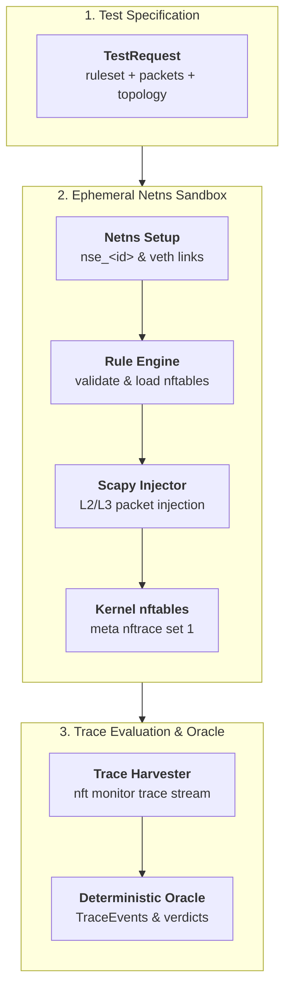

# Network Sandbox Engine (NSE)

**Deterministic Linux network namespace isolation and kernel `nftables` trace evaluation engine.**

---

## What is NSE?

Network Sandbox Engine (NSE) is a Python library and CLI tool designed for testing, verifying, and debugging Linux `nftables` firewall rulesets inside ephemeral network namespaces (`netns`).

NSE allows security engineers, tool developers, and CI/CD pipelines to validate complex network filtering rulesets **without touching the host firewall or requiring dedicated VMs**. The ruleset under test is loaded only inside the sandbox namespaces. A run does create temporary namespaces, the host end of its veth links with their addresses (or, with `isolated_host=True`, a namespace of its own for that end), gateway routes to the sandbox subnets, and ownership records under `/run/nse`. Each is journalled before it is created and removed at teardown, or by recovery after a crash.



---

## Key Features

- **Library and CLI only**: no server, no socket, no daemon. Root privileges are held for the duration of a run and nothing listens.
- **Self-verifying Oracle**: canary packets before and after every run prove the kernel trace was actually being observed, so a blind engine fails instead of reporting a clean result.
- **Wire-level Leak Assertions**: `PCAPAsserter` captures on a named interface, so a test can assert a stimulus produced no frame at all - the question `nft monitor trace` cannot answer.
- **Isolated Topologies**: Supports **Simple** (single sandbox netns) and **Gateway** (router + server netns chain) topologies.
- **Scapy Packet Injection**: Forge arbitrary TCP, UDP, and ICMP packets across IPv4 and IPv6 protocols.
- **Ownership-aware Lifecycle**: every namespace, link and route is journalled before it is created. Teardown and crash recovery remove only what a run can prove it owns, and stop every process still in a sandbox namespace.
- **Managed Processes**: real servers and clients in the sandbox, with a verified UID, GID and capabilities, timeouts, and output limits.
- **Reproducible Reports**: an experiment report and a SHA-256 manifest that let a CI artifact reconstruct a run.
- **Worked Examples, run in CI**: workstation, IPv6, coexisting tables, NAT gateway, a real application, and two experiments that must fail; see [Worked Examples](tutorials/examples.md).
- **Full Type Safety & Strict Lints**: Built with Pydantic v2, `mypy --strict`, `import-linter`, and `ruff`.

---

## Quick Example

```python
import asyncio
from nse.core.netns_controller import NetnsController
from nse.core.pipeline import run_test_pipeline
from nse.models.test_request import TestRequest, PacketSpec

rules = """
table ip filter {
    chain input {
        type filter hook input priority 0; policy drop;
        tcp dport 80 accept
    }
}
"""

request = TestRequest(
    rules=rules,
    packets=[
        PacketSpec(protocol="tcp", src_ip="10.0.0.1", dst_ip="10.0.0.2", dst_port=80),
        PacketSpec(protocol="tcp", src_ip="10.0.0.1", dst_ip="10.0.0.2", dst_port=22),
    ],
)

async def main():
    controller = NetnsController()
    events = await run_test_pipeline(request=request, controller=controller)
    for evt in events:
        if evt.verdict:
            print(f"Packet verdict: {evt.verdict}")

asyncio.run(main())
```

---

## Navigation & Sections

- **[Quickstart Guide](tutorials/quickstart.md)**: Get up and running in 5 minutes.
- **[Test Suite YAML](tutorials/test-suites.md)**: Define declarative YAML test suites for CLI execution.
- **[Worked Examples](tutorials/examples.md)**: complete experiments with their expected output, including two that must fail.
- **[Embedding NSE](how-to/in-process-integration.md)**: call the engine directly from your own Python test suite.
- **[Architecture & Flow](explanation/architecture.md)**: In-depth breakdown of in-process netns execution.
- **[Python API Reference](reference/api.md)**: Complete auto-generated Python API documentation.
